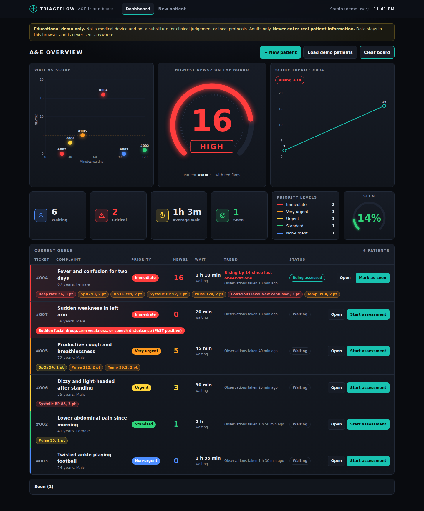

# TriageFlow: A&E triage board

An educational web app that keeps a live board of A&E patients, runs a rapid ABCDE check, scores observations with **NEWS2**, and ranks everyone by how critical they are, **showing its reasoning at every step**.



> **Educational tool only.** Not a medical device. Not a substitute for clinical judgement or local protocols. Adults only. **Never enter real patient information.**

Built by a medical student who wanted to see what the reasoning behind triage looks like when it is made explicit.

## Design

A dark, high-density control-room look. The hero is a gauge showing the highest NEWS2 on the board (7 or more is high, 5 to 6 medium, below 5 low), flanked by a wait-versus-score chart and the score trend for that patient. Below sit the headline numbers, a priority legend, and the live queue. Colours are the triage bands, so red always means Immediate.

## Workflow

```
+ New patient (bio data, presenting complaint)
      ↓
Rapid ABCDE check (red flags) + vital signs
      ↓
Suggested priority, with reasons
      ↓
Added to the live queue, ranked by criticality
      ↓
Open patient → Start assessment → Reassess or Mark as seen
```

## What it does

- **Overview:** waiting, critical, average wait and seen counts, plus a count per priority band.
- **Live queue:** most critical first. Rows show a ticket number and presenting complaint, **not the name**, so a screenshot of the board identifies nobody. Names appear only when a patient is opened.
- **Rapid ABCDE check:** seven red flags grouped under Airway, Breathing, Circulation and Disability. Breathing, Circulation, Disability and Exposure are also scored through the vital signs. **Any ticked red flag overrides the score.**
- **NEWS2 scoring** (Royal College of Physicians, 2017) with cells coloured like a real observation chart.
- **Patient statuses:** Waiting, Being assessed, Seen. Seen patients leave the queue and can be reopened.
- **Reassessment** keeps the observation history and shows whether the score is rising or falling.
- **Intake validation:** patients under 16 are rejected (NEWS2 does not apply), implausible values such as a respiratory rate of 160 are caught, and partial observations are refused unless a red flag is ticked, because a partial set understates the score.

### How the score maps to a band

| Condition | Suggested band |
| --- | --- |
| Any red flag, or NEWS2 ≥ 7 | Immediate (red) |
| NEWS2 5 to 6 | Very urgent (orange) |
| Any single parameter scoring 3 | Urgent (yellow) |
| NEWS2 1 to 4 | Standard (green) |
| NEWS2 0, no red flags | Non-urgent (blue) |

NEWS2 is an early warning score, not a triage system. It ignores the presenting complaint, so a patient with normal observations scores 0 unless a red flag is ticked. Mapping it to Manchester-style colours is a **teaching simplification**, and the bands and timings are illustrative.

Within a band, patients are ordered by NEWS2, then by who has waited longest. A patient who cannot be placed in a band sorts to the top so nobody is missed. The order is a convenience: the clinician decides who is seen next.

## Privacy

This is a demo. There is no backend: data is kept in the browser's local storage on the device and is never sent anywhere. The demo patients are fictional. A real clinical tool would need consent, access control, audit logging and compliance with data protection law (for example the NDPA in Nigeria), and none of that exists here.

## Design decisions

- **Clinical logic is separate from the UI.** `src/lib/news2.ts`, `triage.ts` and `patients.ts` are pure functions with no React, so they are easy to read, test and audit.
- **Boundary tests** check the value on each side of every NEWS2 threshold.
- **Render tests** check that the board lists patients in the right order and never shows a name.
- **No backend.** Everything runs in the browser.

## Run it

```bash
npm install
npm run dev        # local dev server
npm test           # unit and render tests
npm run typecheck
npm run build      # production build in dist/
```

## Deploy

Push to GitHub, import the repo into Vercel or Netlify, and accept the Vite defaults (build `npm run build`, output `dist`).

## Known limitations

- Adults only. Not validated for children (a PEWS version would be needed) or pregnancy.
- SpO₂ **scale 1** only. Scale 2 (chronic hypercapnic respiratory failure) is not implemented.
- The red-flag list is deliberately short and is not exhaustive. GCS and pain score are not recorded.
- Single device, single user: there is no shared board.
- Not clinically validated. Review by a qualified clinician is welcome via an issue.

## Roadmap

- [ ] Clinician review of thresholds, red flags and band wording
- [ ] Escalation prompt when the score rises by 2 or more
- [ ] Observation history chart per patient
- [ ] Offline support (PWA)
- [ ] Paediatric version (PEWS)
- [ ] SBAR handover summary export
- [ ] Shared board with accounts (Supabase), only with synthetic data

## Reference

Royal College of Physicians. *National Early Warning Score (NEWS) 2: Standardising the assessment of acute-illness severity in the NHS.* 2017.

## Licence

MIT
